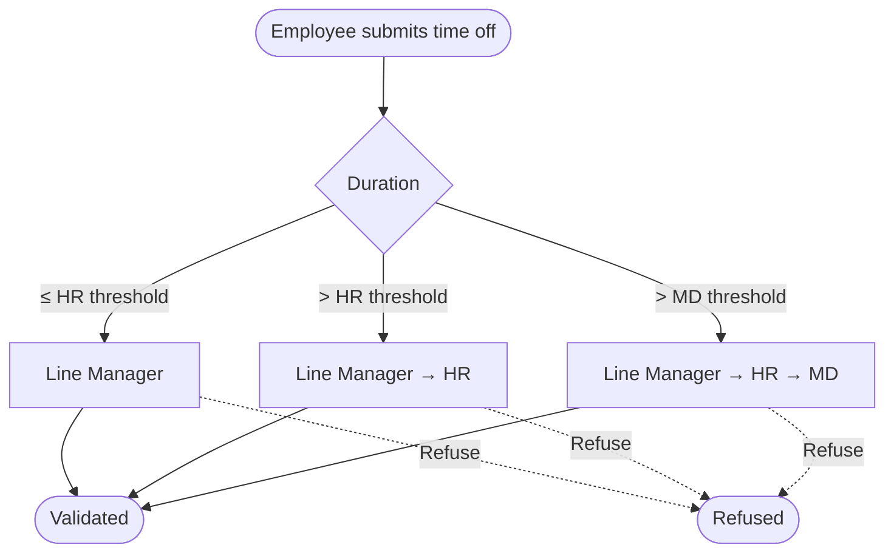
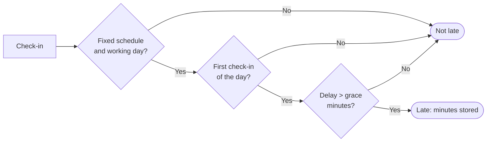
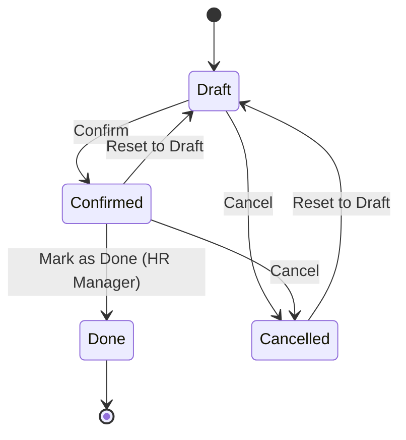
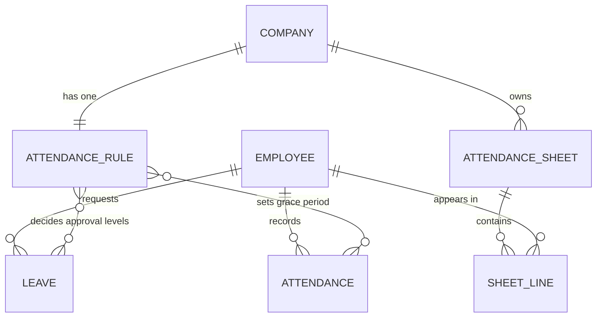

# HR Leave, Attendance & Overtime Plus

[](https://www.odoo.com)
[](https://www.gnu.org/licenses/lgpl-3.0)

An Odoo 19 module for companies running **Odoo Community**, where Payroll is not available. It extends `hr_holidays` and `hr_attendance` with a **multi-level time off approval chain**, **late-arrival detection**, **overtime pay** and a **monthly attendance & salary-deduction sheet**, plus a read-only employee portal.

[**[See Screenshots]**](#screenshots)

---

## Features

| Area | What you get |
|------|--------------|
| **Time off approval chain** | Line Manager → HR → Managing Director. The number of levels depends on the duration of the request. |
| **Approver rules** | Nobody approves their own time off. Optionally, one user cannot approve two levels of the same request. |
| **Approval notifications** | To-do activity for the approvers of the current level, plus a daily reminder for requests that wait too long. |
| **Late arrivals** | Every attendance is compared with the employee's working schedule. The first check-in of the day is late when it is after the scheduled start plus the grace period. |
| **Monthly sheet** | One sheet per company and month, with a line per employee: working, present, time off, absent, late and overtime figures. |
| **Deductions & overtime** | Late penalty, absence and unpaid time off deductions, and overtime pay, all calculated from configurable salary-base rules. |
| **Automation** | Daily cron generates last month's sheet. Daily cron reminds pending approvers. |
| **Reports** | QWeb PDF of the monthly sheet (A4 landscape). |
| **Employee portal** | Employees see their own time off (with approval status) and attendance (with late minutes and overtime). |
| **Security** | A dedicated Managing Director group, HR user and manager access rights, and multi-company record rules. |

---

## Workflow

### Time off approval chain

The required levels depend on the duration of the request (see [Configuration](#configuration)).



| Level | Who can approve |
|-------|-----------------|
| **Line Manager** | The employee's time off approver (`leave_manager_id`) or any Time Off Officer |
| **HR** | Time Off Officers |
| **MD** | Members of the *Managing Director: final time off approval* group |

How it behaves:

- The **Approve** button on the time off form is replaced by the chain button. It is visible only to a user who can approve the **current** level.
- Each approval stores the approver and the date, posts a message in the chatter and completes that user's to-do.
- When the last required level approves, the standard Odoo validation runs (resource leaves, allocation consumption and so on).
- Moving a validated request back to approval **restarts the whole chain**.
- Leave types with no validation keep the standard automatic behavior.
- Approvers of a level can also **Refuse** the request from the form.

### Late arrival detection



- The scheduled start is the first working interval of the employee's calendar for that day, in the calendar's timezone.
- Flexible schedules, weekends, public holidays and full-day time off are never late.
- Lunch-break check-ins are ignored: only the first check-in of the day can be late.

### Monthly sheet lifecycle



| Step | Action | What happens |
|------|--------|--------------|
| 1. **Draft** | Sheet is created manually or by the cron | Period dates and name (e.g. *March 2026*) are computed from month and year. |
| 2. **Generate Lines** | Adds a line for each missing employee of the company (optionally filtered by departments) | Figures of every line are computed from attendances and time off. |
| 3. **Review** | HR edits the figures, notes or monthly gross on the lines | Amounts recompute instantly. |
| 4. **Refresh Figures** *(optional)* | Recomputes all figures from the data | Manual edits on the lines are overwritten, except the monthly gross. |
| 5. **Confirm** | Requires at least one line | Lines become read-only. |
| 6. **Mark as Done** *(HR Manager)* | Requires a confirmed sheet | Sheet is final and cannot be cancelled or deleted. |

### Figures on a sheet line

| Figure | How it is computed |
|--------|--------------------|
| **Working days** | Days with a work interval in the month (weekends and public holidays excluded). |
| **Present** | Distinct days with at least one check-in in the month. |
| **Time off** | Validated time off in the month. A request that overlaps two months is counted for the covered working days only. |
| **Unpaid time off** | The part of the time off whose leave type is marked unpaid. |
| **Absent** | Working days **before today** with no attendance and no time off. |
| **Late arrivals / minutes** | Sum of the late attendances of the month. |
| **Approved overtime** | Sum of the validated overtime hours of the attendances. |
| **Monthly gross** | Copied from the employee's wage when empty. Editable on the line. |

### Salary-deduction formulas

```
late penalty days = (late arrivals ÷ late days per penalty, rounded down) × penalty days
deduction days    = late penalty days + absent days + unpaid time off days
per day           = monthly gross ÷ days in month
per hour          = per day ÷ working hours per day
deduction         = deduction days × per day
overtime pay      = overtime hours × per hour × overtime multiplier
net adjustment    = overtime pay − deduction
```

**Example** (default rules, gross 30 000): 6 late arrivals, 1 absent day, 8 overtime hours.

| | Value |
|---|---|
| Late penalty | 6 ÷ 3 = 2 days |
| Deduction days | 2 + 1 = 3 days → 3 × 1 000 = **3 000** |
| Overtime pay | 8 h × 125 × 2 = **2 000** |
| Net adjustment | 2 000 − 3 000 = **−1 000** |

### Automation (scheduled actions)

| Cron | Interval | Job |
|------|----------|-----|
| `Attendance Sheet: generate last month's sheet` | Daily | During the **first 5 days** of a month, creates last month's sheet for every company and generates its lines. It never recreates an existing sheet. |
| `Time Off: remind pending approvals` | Daily | For every request still waiting for approval longer than the configured delay, schedules a reminder to-do for the approvers of the current level (no duplicates). |

---

## Roles & Security

| Role | What they see and can do |
|------|--------------------------|
| **Employee** | Own time off and own attendance only. The **Approval Chain** section of a leave shows *Required Approvals* and *Waiting For*, with no Approve or Refuse button. No Approvals, Late Arrivals, Monthly Sheets or Rules menu. |
| **Line Manager** | Set as the employee's time off approver, so Odoo gives them the **Time Off > Approvals** menu. Sees the requests of their team and gets the Approve button only while *Waiting For = Line Manager*. No Monthly Sheets or Rules menu. |
| **HR** | Sees all requests in **Time Off > Approvals**. Approves while *Waiting For = HR*, and also at the Line Manager level, but not at the MD level. Sees **Late Arrivals** and **Monthly Sheets**, and can create a sheet, generate lines and confirm it. No Rules menu and no *Mark as Done* button (HR Manager only). |
| **Managing Director** | Sees every menu, including Rules and *Mark as Done* (when also an Administrator). Approves while *Waiting For = Managing Director*, the last level: the time off becomes Approved. Nobody can approve their own time off. |

---

## Configuration

**Attendance → Configuration → Leave & Attendance Rules** (HR Manager). There is one set of rules per company, created automatically with the defaults below.

| Setting | Default | Meaning |
|---------|---------|---------|
| HR Approval Above (days) | `3.0` | Time off longer than this also needs HR approval. |
| MD Approval Above (days) | `7.0` | Time off longer than this also needs the MD approval. Must not be lower than the HR threshold. |
| Distinct Approvers | off | One user cannot approve two levels of the same request. |
| Reminder After (days) | `2` | Delay before a reminder to-do is sent to the current approvers. |
| Grace Period (minutes) | `10` | Tolerance before a check-in counts as late. |
| Late Days per Penalty | `3` | Late arrivals in a month that trigger one penalty. |
| Penalty (days of salary) | `1.0` | Days of salary deducted for each group of late arrivals. |
| Days in Month (salary base) | `30` | Divisor used to get the daily rate. |
| Working Hours per Day | `8.0` | Divisor used to get the hourly rate. |
| Overtime Rate Multiplier | `2.0` | Overtime is paid at this multiple of the hourly rate. |

To assign the MD, add the user to **Managing Director: final time off approval** (under the *Leave & Attendance Plus* privilege in the user form).

---

## Where to find things

| What | Where |
|------|-------|
| Approval chain on a request | Time Off form, **Approval Chain** section, and the *Waiting For* column in the list |
| Late arrivals list | **Attendance → Late Arrivals** (Attendance Officers) |
| Late count of an employee | Smart button **Late (this month)** on the employee form (HR User) |
| Monthly sheets | **Attendance → Monthly Sheets** (HR User) |
| Rules | **Attendance → Configuration → Leave & Attendance Rules** (HR Manager) |
| Sheet PDF | **Print → Monthly Attendance Sheet** on a sheet |
| Portal | `/my/leaves` and `/my/attendance`, with counters on the portal home page |

---

## Installation

### Requirements

- Odoo **19.0** (Community or Enterprise)
- Odoo apps: `hr`, `hr_holidays`, `hr_attendance`, `portal`, `mail`

The module has no dependency on Payroll or Contracts. The monthly gross is read from the employee's current version (`version_id.wage`).

### Steps

```bash
# 1. Copy the module into your custom addons directory
cp -r hr_leave_attendance_plus /path/to/custom_addons/

# 2. Add the directory to addons_path in odoo.conf
#    addons_path = /opt/odoo/addons,/path/to/custom_addons

# 3. Restart Odoo and install
./odoo-bin -c odoo.conf -d <your_db> -i hr_leave_attendance_plus
```

Or: **Apps → Update Apps List → search "HR Leave, Attendance & Overtime Plus" → Install**.

---

## Tests

```bash
./odoo-bin -c odoo.conf -d <test_db> -i hr_leave_attendance_plus \
    --test-tags /hr_leave_attendance_plus --stop-after-init
```

The suite (`post_install`) covers:

- Rule validation: the MD threshold cannot be lower than the HR threshold
- Sheet period and name computation
- Line amounts: late penalty, deduction, overtime pay and net adjustment
- One sheet per company and month

---

## Module Structure

```
hr_leave_attendance_plus/
├── __init__.py
├── __manifest__.py
├── controllers/
│   └── portal.py                       # /my/leaves, /my/attendance
├── data/
│   ├── hr_attendance_rule_data.xml     # default rules (main company)
│   └── ir_cron_data.xml                # sheet generation + approval reminders
├── models/
│   ├── hr_attendance_rule.py           # Company rules
│   ├── hr_attendance.py                # Late detection
│   ├── hr_employee.py                  # Late count smart button
│   ├── hr_leave.py                     # Approval chain
│   └── hr_attendance_sheet.py          # Sheet, lines, figures, cron
├── report/
│   └── hr_attendance_sheet_report.xml  # Paper format, action, QWeb template
├── security/
│   ├── hr_leave_attendance_plus_security.xml  # MD group, record rules
│   └── ir.model.access.csv
├── views/
│   ├── hr_attendance_rule_views.xml
│   ├── hr_leave_views.xml
│   ├── hr_attendance_views.xml
│   ├── hr_employee_views.xml
│   ├── hr_attendance_sheet_views.xml
│   ├── portal_templates.xml
│   └── menus.xml
└── tests/
    └── test_sheet.py
```

---

## Data Model



| Model | Type | Purpose |
|-------|------|---------|
| `hr.attendance.rule` | new | Approval thresholds, late policy and salary base, one per company |
| `hr.attendance.sheet` | new | Monthly sheet with state, totals and chatter |
| `hr.attendance.sheet.line` | new | Per-employee figures and amounts |
| `hr.attendance` | extended | `scheduled_start`, `late_minutes`, `is_late` (stored) |
| `hr.leave` | extended | `required_level`, `approval_stage` and the three approver/date pairs |
| `hr.employee` | extended | `late_count_month` and the smart button action |

---

## Screenshots


---

## Notes

- Lateness is stored on each attendance when it is computed. If you change the grace period or an employee's schedule later, old attendances keep their stored values.
- Late arrivals are counted from the stored `is_late` flag. Time off and public holidays follow the employee's resource calendar.
- Absent days are counted only for working days **before today**, so a sheet generated mid-month does not count the future days as absent.
- A time off that crosses two months is split by working days that fall inside the sheet month.
- The sheet computes **amounts only**. It does not create payslips or accounting entries. Use the PDF or the figures as input for your salary process.
- The monthly gross is kept once set. If the employee's wage changes, edit it on the line (Refresh Figures does not overwrite it).
- Sheets in *Confirmed* state can be reset to draft. *Done* sheets cannot be cancelled or deleted.

---

## License

Distributed under the **LGPL-3** license.
